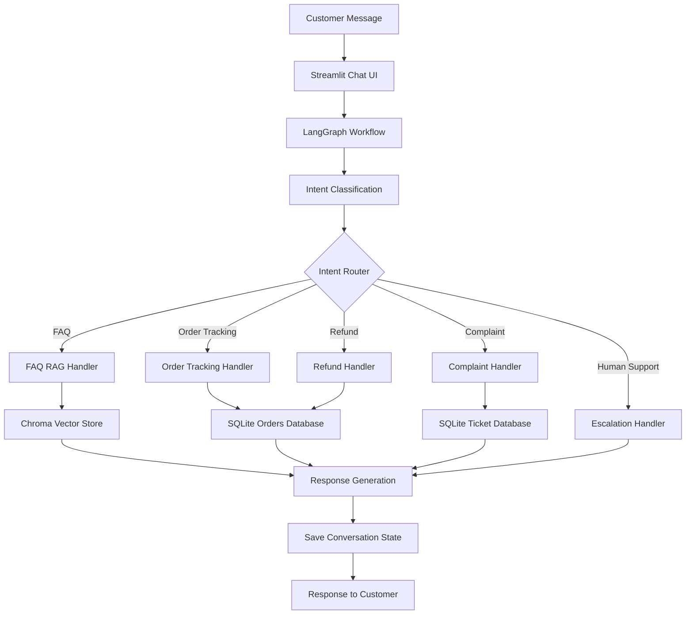

# 🤖 AI Customer Support Agent

An intelligent, conversational customer support system built with **Python, LangGraph, LangChain, Google Gemini, Retrieval-Augmented Generation (RAG), Streamlit, and SQLite**.

The agent understands customer queries, identifies their intent, retrieves relevant FAQ information, tracks orders, evaluates refund eligibility, creates complaint tickets, and provides human-support escalation messages. It also maintains conversation context to handle follow-up questions naturally.

🔗 **GitHub Repository:** [AI Customer Support Agent](https://github.com/nausheenali02/AI-Customer-Support-Agent)

---

## 📌 Project Overview

Traditional customer support systems often rely on static FAQs, predefined responses, and manual routing. This project explores how an AI-powered agent can make customer support more conversational, context-aware, and efficient.

The system uses **LangGraph to orchestrate a multi-step workflow**. Based on the customer's message and conversation history, it classifies the intent and routes the request to the appropriate handler.

For knowledge-based queries, it uses a RAG pipeline to retrieve relevant FAQ information. For operational queries, it uses tools connected to a local SQLite database.

### 🎯 Key Objectives

- Automate common customer support interactions.
- Understand customer intent and route requests to appropriate handlers.
- Generate context-aware answers using retrieval-augmented generation.
- Maintain conversational context across follow-up messages.
- Integrate database-backed order tracking and refund eligibility checks.
- Create complaint tickets programmatically.
- Provide a foundation for human-support escalation and future integrations.

---

## ✨ Features

### 1. 🧠 Intent Classification and Routing

The agent analyzes customer messages using Google Gemini and identifies the appropriate support intent.

Supported intents include:

- **FAQ:** Product information, policies, and frequently asked questions.
- **Order Tracking:** Order status and estimated delivery information.
- **Refund Requests:** Refund eligibility and cancellation guidance.
- **Complaints:** Complaint submission and ticket creation.
- **Human Support:** Escalation messages for cases requiring additional assistance.

LangGraph routes the request to the corresponding workflow node based on the classified intent.

### 2. 📚 Retrieval-Augmented Generation (RAG)

The FAQ assistant combines document retrieval with an LLM to provide answers grounded in the project's knowledge base.

The RAG pipeline includes:

1. Loading FAQ documents from `data/faq.txt`.
2. Generating embeddings using Google's `gemini-embedding-001` embedding model.
3. Storing document embeddings in a persistent Chroma vector database.
4. Retrieving relevant FAQ content for a customer query.
5. Using the retrieved context to generate a response with Google Gemini.

This approach helps the assistant answer knowledge-based questions using relevant source material instead of relying exclusively on the LLM's general knowledge.

### 3. 📦 Database-Backed Order Tracking

The order-tracking handler connects to a local SQLite database to retrieve order information.

It supports:

- Order ID extraction from customer messages.
- Retrieval of order details and current status.
- Estimated delivery information.
- Follow-up questions that refer to a previously mentioned order.
- Clear responses when an order ID is missing or invalid.

Example:

**Customer:** Where is my order ORD1001?

**Assistant:** Your order ORD1001 for Wireless Headphones is currently Shipped. Estimated delivery: 2026-10-18.

*The example reflects the sample database data used during development; order details and dates can change.*

### 4. 💳 Refund Eligibility Handling

The refund handler checks order information and applies predefined business rules.

Current behavior includes:

- Checking whether an order has been delivered.
- Evaluating the refund window for eligible delivered orders.
- Using delivery dates to determine eligibility.
- Providing cancellation guidance for orders that have not yet been delivered.

The current implementation uses a **seven-day refund window** for delivered orders. Actual refund approval, payment processing, and external payment gateway integration are not implemented.

### 5. 📝 Complaint Ticket Creation

The complaint handler creates support tickets and stores them in SQLite.

This demonstrates how an AI agent can move beyond generating text and perform a structured action through a tool.

### 6. 💬 Conversation Memory

The project uses LangGraph's checkpointing mechanism to preserve conversation state across turns.

This enables the agent to:

- Retain relevant conversational context.
- Understand follow-up messages.
- Reuse a previously supplied order ID.
- Switch between support intents while maintaining conversation history.

For example:

- **Customer:** Where is my order ORD1001?
- **Customer:** When will it arrive?
- **Customer:** Can I get a refund for it?

The assistant can use the existing conversation context to interpret follow-up questions without requiring the customer to repeat all the information.

### 7. 🖥️ Streamlit Chat Interface

The application provides a chat-based interface built with Streamlit.

Features include:

- Interactive customer and assistant messages.
- A chat input for natural-language queries.
- A loading indicator while the agent processes a request.
- A persistent conversation view during the Streamlit session.
- Integration with the LangGraph support workflow.

### 8. 🛡️ Basic Error and Missing-Information Handling

The project includes handling for common situations such as:

- Missing order IDs.
- Invalid order IDs.
- Unsupported or unrelated questions.
- Requests requiring human assistance.
- Exceptions raised while processing a request.

Error handling and unsupported-intent classification can be further improved as the project evolves.

---

## 🏗️ System Architecture

The application follows a modular, graph-based architecture that separates intent classification, workflow routing, business logic, retrieval, and tool execution.



### Workflow Explanation

1. The customer submits a message through the Streamlit interface.
2. The LangGraph workflow receives the message and available conversation state.
3. The intent classifier determines the appropriate support category.
4. The router directs the request to the relevant handler.
5. The handler retrieves information, applies business rules, or executes a database operation.
6. The workflow saves the conversation context using LangGraph checkpointing.
7. The generated response is displayed to the customer.

---

## 🛠️ Tech Stack

| Technology | Purpose |
|---|---|
| Python | Core programming language |
| LangChain | LLM integration and retrieval components |
| LangGraph | Workflow orchestration, routing, and state management |
| Google Gemini | Intent classification and response generation |
| Google Gemini Embeddings | FAQ document embeddings |
| ChromaDB | Persistent vector storage and semantic retrieval |
| SQLite | Order data and complaint ticket storage |
| Streamlit | Interactive chat interface |
| Git and GitHub | Version control and project hosting |

---

## 📂 Project Structure

```text
AI-Customer-Support-Agent/
│
├── app/
│   ├── config.py
│   ├── llm.py
│   ├── state.py
│   │
│   ├── graph/
│   │   ├── router.py
│   │   └── workflow.py
│   │
│   ├── nodes/
│   │   ├── intent_classifier.py
│   │   ├── faq_handler.py
│   │   ├── order_tracker.py
│   │   ├── refund_handler.py
│   │   └── complaint_handler.py
│   │
│   ├── rag/
│   │   ├── ingest.py
│   │   ├── retriever.py
│   │   └── faq_chain.py
│   │
│   └── tools/
│       └── order_tool.py
│
├── data/
│   └── faq.txt
│
├── streamlit_app.py
├── requirements.txt
├── .gitignore
├── .env                 # Local secrets; not committed
└── README.md
```

**Note:** Runtime-generated files and local development artifacts, including the SQLite database and Chroma persistence directory, are excluded from the repository where configured in `.gitignore`.

---

## ⚙️ Installation and Setup

### Prerequisites

Make sure you have:

- Python 3.12 recommended.
- Git.
- A Google Gemini API key.
- A terminal and a code editor such as VS Code.

### Step 1: Clone the Repository

```bash
git clone https://github.com/nausheenali02/AI-Customer-Support-Agent.git
cd AI-Customer-Support-Agent
```

### Step 2: Create a Virtual Environment

```bash
python3.12 -m venv .venv
source .venv/bin/activate
```

On Windows, activate the environment with:

```bash
.venv\Scripts\activate
```

### Step 3: Install Dependencies

```bash
python -m pip install --upgrade pip
pip install -r requirements.txt
```

### Step 4: Configure Environment Variables

Create a `.env` file in the project root:

```env
GOOGLE_API_KEY=your_google_gemini_api_key
```

Replace the placeholder with your own API key.

**Security:** Never commit `.env` to GitHub or hardcode API keys in the source code. The project uses environment-based configuration to load the API key.

### Step 5: Prepare the FAQ Vector Store

Before using FAQ retrieval, ingest the knowledge base into Chroma:

```bash
python -m app.rag.ingest
```

Run this command when setting up the project for the first time or after updating the FAQ documents, as appropriate for the ingestion implementation.

### Step 6: Launch the Application

```bash
streamlit run streamlit_app.py
```

Streamlit will provide a local URL, usually:

```text
http://localhost:8501
```

Open the URL in your browser to interact with the customer support agent.

---

## 💡 Example Customer Queries

Try these queries after starting the application:

| Category | Example query |
|---|---|
| FAQ | What is your return policy? |
| FAQ | How many days are allowed for a refund? |
| Order Tracking | Where is my order ORD1001? |
| Follow-up | When will it arrive? |
| Refund | Can I get a refund for my order? |
| Complaint | I received a damaged product. |
| Human Support | I would like to speak to a support representative. |

The exact response depends on the FAQ knowledge base, sample database records, business rules, and model output.

---

## 🧩 Design Highlights

### Graph-Based Workflow Orchestration

Instead of implementing the entire support process in one large function, the project uses separate LangGraph nodes for individual responsibilities. This makes the workflow easier to understand, test, and extend.

### Tool-Based Actions

Order tracking and complaint creation demonstrate how an LLM-driven workflow can interact with structured data and perform application-level operations.

### Retrieval-Grounded Answers

The FAQ flow retrieves relevant documents from a vector store before generating answers, providing a knowledge-grounded approach to customer support.

### Stateful Conversations

LangGraph checkpointing allows conversation state to persist across requests associated with the same conversation thread.

### Modular Code Organization

The project separates the UI, graph workflow, state definition, support handlers, retrieval pipeline, and database tools to improve maintainability.

---

## 🚧 Current Limitations

This project is a prototype designed for learning and demonstrating AI agent development. It is not yet a production-ready customer support platform.

- **Sample data:** Order information is stored in a local SQLite database.
- **Refund processing:** The system evaluates predefined rules but does not issue refunds or connect to a payment provider.
- **Human escalation:** The current handler provides an escalation response; it does not connect to a live support team or ticketing platform.
- **Authentication:** Customer identity verification and access control are not implemented.
- **Conversation storage:** LangGraph memory and the Streamlit chat history have different lifecycles; durable conversation history across application restarts requires additional configuration and persistence.
- **Production readiness:** Authentication, observability, automated tests, rate-limit handling, deployment configuration, and stronger validation need further work.

These limitations define clear opportunities for future development.

---

## 🔮 Future Enhancements

- Add automated unit and integration tests for all support flows.
- Improve intent classification for unsupported and ambiguous requests.
- Add confidence-based routing and clarification questions.
- Improve handling of Gemini API errors, quota limits, and network failures.
- Add a dedicated order lookup and customer verification flow.
- Integrate a real ticketing platform for human escalation.
- Add secure customer authentication and authorization.
- Improve durable conversation persistence and session management.
- Add structured logging, tracing, and workflow observability.
- Deploy the application using Streamlit Community Cloud or another hosting platform.
- Add CI/CD checks and a deployment-ready configuration.

---

## 👩‍💻 Author

**Nausheen Ali**

B.Tech Computer Science Engineering | AI/ML Enthusiast

Interested in LLM applications, Agentic AI, RAG pipelines, and intelligent workflow automation.

- **GitHub:** [@nausheenali02](https://github.com/nausheenali02)
- **LinkedIn:** [Nausheen Ali](https://www.linkedin.com/in/nausheen-ali-72583628a/)


*Built as a hands-on project to explore LLM-powered customer support, retrieval-augmented generation, tool integration, and stateful AI workflows.*
